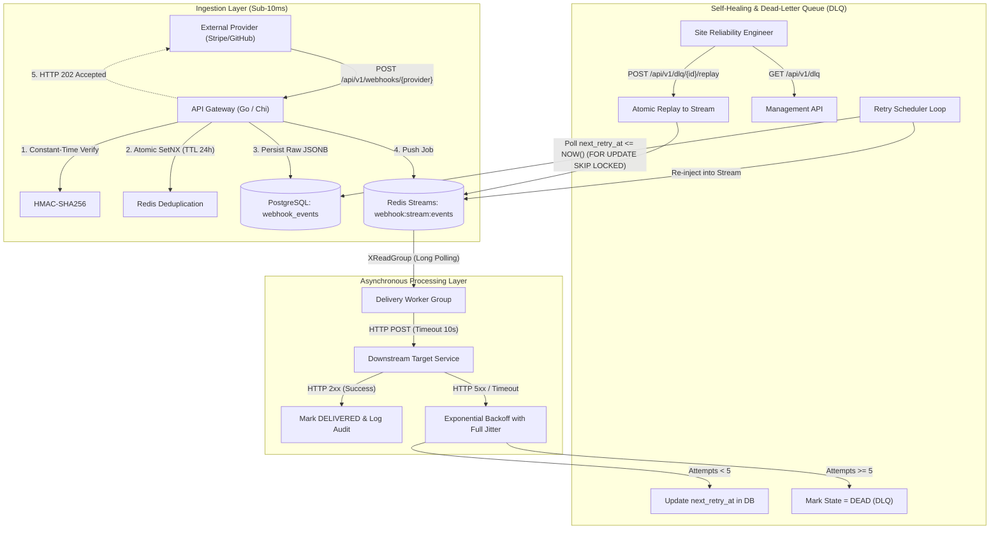

# Reliable Webhook Gateway

An enterprise-grade, highly available webhook ingestion and delivery gateway built with **Go**, **PostgreSQL**, and **Redis Streams**. Designed to guarantee **at-least-once delivery**, sub-10ms acknowledgment, and resilience against downstream service degradation.

[](https://github.com/MhmdBike/reliable-webhook-gateway/actions)


---

## The Problem

External webhook providers (Stripe, GitHub, Shopify, etc.) enforce aggressive HTTP request timeouts (typically under 2 to 5 seconds). When receiving backends execute heavy synchronous business logic or experience internal database bottlenecks, provider connections time out, triggering catastrophic re-delivery storms and inconsistent state across services.

**Reliable Webhook Gateway** solves this by decoupling ingestion from execution:
1. Fast-acknowledges events within **< 10ms** using `202 Accepted`.
2. Verifies cryptographic signatures at wire speed.
3. Defends against duplicate payloads atomically.
4. Asynchronously schedules and dispatches deliveries using configurable exponential backoff and persistent dead-letter replay.

---

## Architectural Topology



---

## Engineering Trade-offs & Deep Dive

| Architectural Challenge | Naive / Trivial Approach | Our Solution | Engineering Rationale |
|---|---|---|---|
| **Downstream Ingestion Lag** | Direct synchronous proxying to internal services | **Decoupled Queueing via Redis Streams** | Provider SLAs are strictly met; external callers never experience latency drops or timeout disconnects caused by internal delays. |
| **Duplicate Delivery (Idempotency)** | Simple in-memory maps or application-level state checks | **Redis `SetNX` + Postgres Composite Unique Index** | In-memory sets fail across distributed multi-replica architectures. Our solution combines fast sub-millisecond in-memory locking with durable DB constraints. |
| **Worker Collision & Race Conditions** | Pessimistic whole-table locking during retry selection | **`FOR UPDATE SKIP LOCKED` (CTE)** | Enables horizontal worker replica scaling. Workers concurrently acquire overdue tasks without contending for identical row locks or blocking throughput. |
| **Thundering Herd On Recovery** | Static interval retries (e.g., retry every 30s) | **Exponential Backoff with Full Jitter (±20%)** | Staggers network retries across decaying temporal curves, preventing concurrent stampedes from crushing downstream services right as they recover. |
| **Cryptographic Timing Side-Channels** | Standard string comparisons (`==`) | **Constant-Time Verification (`hmac.Equal`)** | Standard equality exits early upon detecting the first divergent byte, leaking microsecond timing hints that attackers use to deduce valid signatures. |

---

## API Specifications

### 1. Ingest Inbound Webhook
```bash
curl -i -X POST http://localhost:8080/api/v1/webhooks/stripe   -H "Content-Type: application/json"   -H "X-Idempotency-Key: evt_unique_identifier_001"   -H "X-Signature-SHA256: <computed_hex_digest>"   -d '{"event": "payment.succeeded", "amount": 4900, "currency": "usd"}'
```
**Response:** `202 Accepted`
```json
{
  "event_id": "338ea394-2786-4c6c-be4b-ce22226c0dce",
  "message": "Webhook accepted and queued for delivery"
}
```

### 2. Query Dead-Letter Queue (DLQ)
```bash
curl -s http://localhost:8080/api/v1/dlq
```

### 3. Inspect Complete Delivery Audit Log
```bash
curl -s http://localhost:8080/api/v1/events/{event_id}/attempts
```

### 4. Replay Dead Event
```bash
curl -i -X POST http://localhost:8080/api/v1/dlq/{event_id}/replay
```

---

## Quickstart & Local Setup

### Prerequisites
- Docker Engine & Docker Compose
- Go 1.23+

### Running the System
```bash
# 1. Clone repository
git clone https://github.com/MhmdBike/reliable-webhook-gateway.git
cd reliable-webhook-gateway

# 2. Boot infrastructure
docker compose up -d

# 3. Apply PostgreSQL migrations
docker exec -i webhook_postgres psql -U gateway_user -d webhook_gateway < migrations/001_init_schema.sql

# 4. Start Ingestion Server
go run cmd/server/main.go

# 5. Start Delivery Worker (separate shell)
go run cmd/worker/main.go
```
